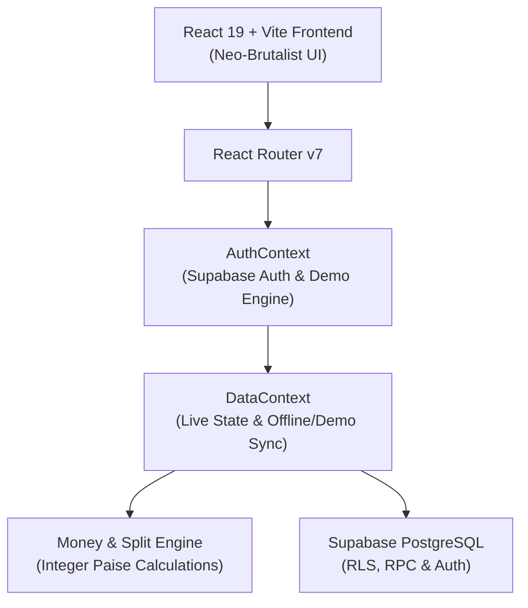
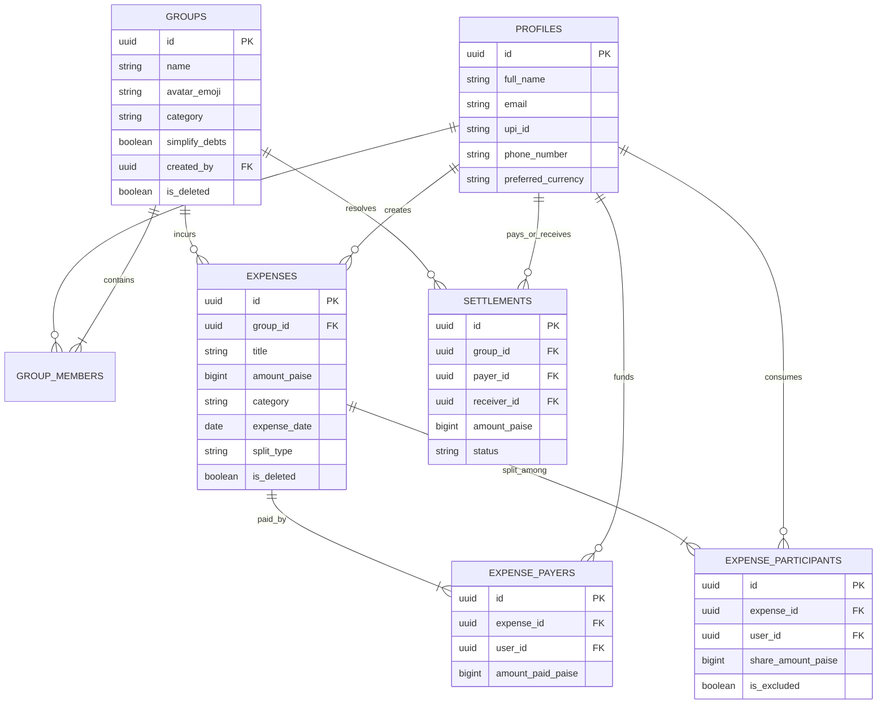

# Architecture & Design Specifications — HisabBhai

> **“Bhai, hisaab clear kar!”**  
> Indian Expense-Sharing Application built with React, TypeScript, Tailwind CSS (Neo-Brutalism), and Supabase PostgreSQL.

---

## 1. System Overview

HisabBhai is designed to eliminate financial ambiguity for Indian roommates, road trips, and friend circles. The platform provides:
- **Integer Paise Precision:** Complete eradication of floating-point arithmetic errors. 1 Rupee = 100 Paise.
- **Deterministic Residual Allocation:** Residual paise are allocated deterministically to participants based on fractional ranks or index order, guaranteeing zero currency loss.
- **Explicit Member Exclusion:** Any participant can be explicitly marked as excluded (`is_excluded = true`), guaranteeing zero financial liability for that transaction.
- **Greedy Debt Simplification:** Reduces complex web of debts down to minimal transfers.
- **Neo-Brutalist Visual Engine:** Mobile-first, bold borders, hard offset shadows, high contrast, and animated step-by-step money flows.

---

## 2. Database Schema & Entity Relationships

---

## 3. Financial Calculation & Debt Simplification Engine

### 3.1 Integer Arithmetic & Zero-Leak Split Formula
- Float arithmetic (e.g., `100 / 3 = 33.333333333333336`) leads to unaccounted paise.
- HisabBhai calculates:
  $$\text{baseShare} = \lfloor \text{amountPaise} / N \rfloor$$
  $$\text{remainder} = \text{amountPaise} \pmod N$$
- The first $\text{remainder}$ non-excluded participants receive $(\text{baseShare} + 1)$ paise, and the remaining receive $\text{baseShare}$ paise.
- **Invariant:** $\sum_{i=1}^N \text{sharePaise}_i \equiv \text{totalAmountPaise}$.

### 3.2 Excluded Participant Rule
- When `is_excluded == true`, `share_amount_paise` is strictly set to `0`.
- The total amount is distributed only among participants with `is_excluded == false`.
- If an excluded participant paid some or all of the expense, their payment is credited in full towards their group balance, allowing them to be reimbursed without incurring consumption liabilities.

### 3.3 Greedy Debt Simplification
1. For every member $u$ in group $g$:
   $$\text{NetBalance}(u) = \sum \text{Paid}(u) - \sum \text{Owed}(u) + \sum \text{Settled}(u)$$
2. Partitions users into:
   - **Debtors:** $\{ u \mid \text{NetBalance}(u) < 0 \}$ with debt $d_u = -\text{NetBalance}(u)$.
   - **Creditors:** $\{ v \mid \text{NetBalance}(v) > 0 \}$ with credit $c_v = \text{NetBalance}(v)$.
3. Sort both descending by outstanding balance.
4. Greedy matching:
   $$\text{transfer} = \min(d_{\text{top}}, c_{\text{top}})$$
   Generate transaction: $\text{Debtor} \xrightarrow{\text{transfer}} \text{Creditor}$.
   Deduct $\text{transfer}$ from both. Repeat until all balances reach 0.

---

## 4. Security & Row Level Security (RLS)

- **Identity derivation:** The authenticated user's ID is retrieved from `auth.uid()`, never trusted from client-supplied payload parameters.
- **Group Isolation:** Access to expenses, payers, participants, and settlements requires membership in the group validated via `public.is_group_member(group_id, auth.uid())`.
- **Atomic Operations:** Settlements and balance updates use the database function `public.record_atomic_settlement()`, which performs validation checks and creates transaction records atomically.
